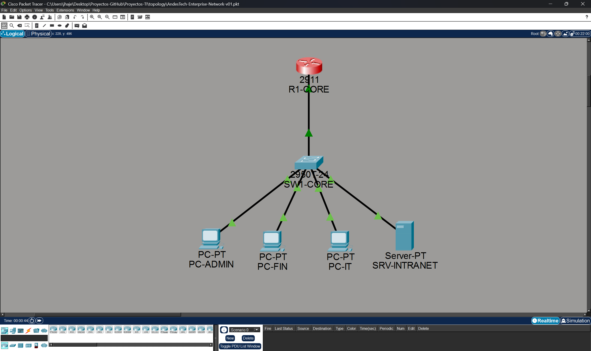
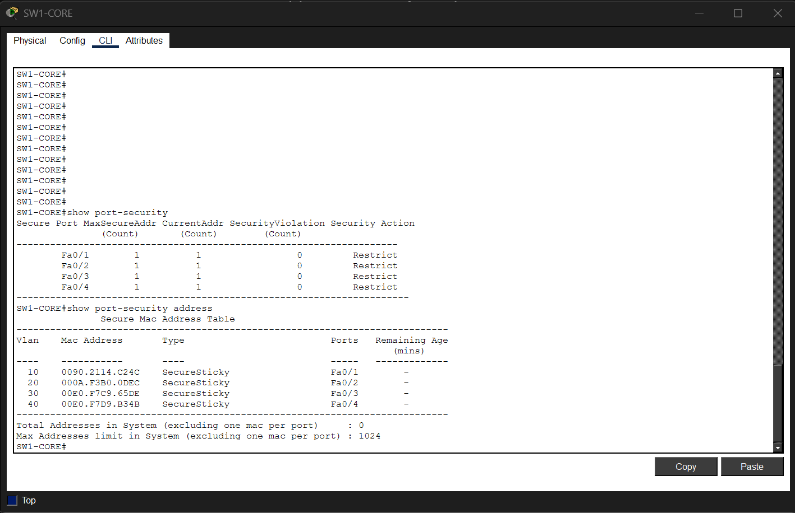
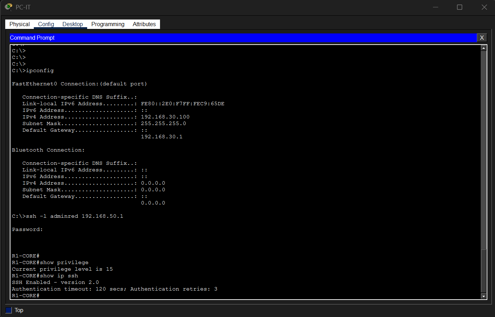
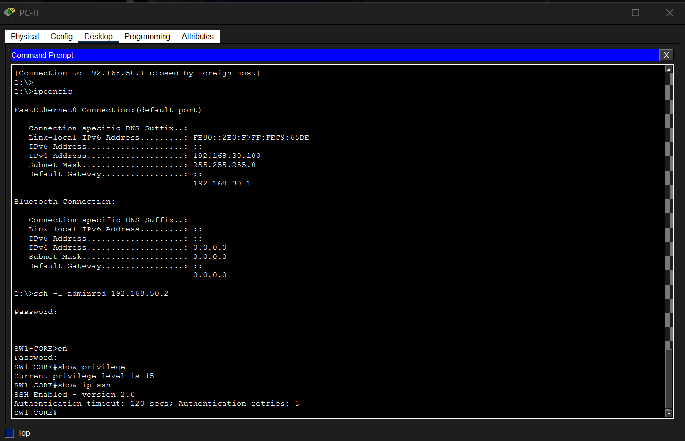
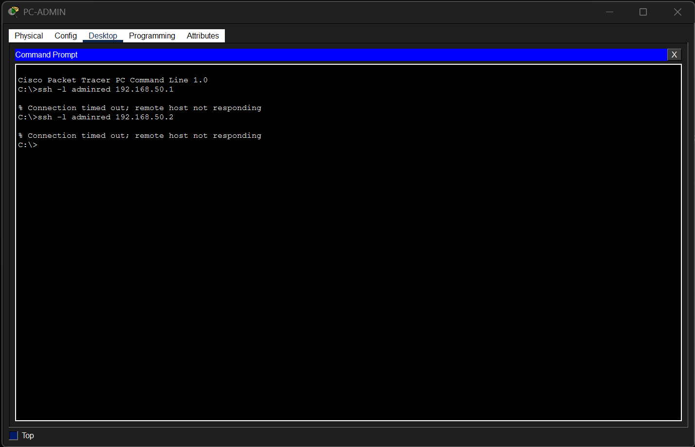
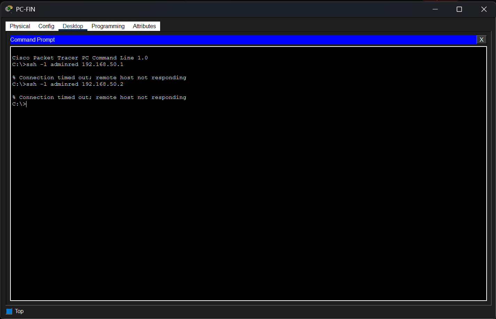

# Proyectos TI — Infraestructura, Redes y Ciberseguridad

Repositorio de proyectos prácticos orientados al diseño, implementación, administración y seguridad de infraestructuras tecnológicas.

El objetivo es documentar soluciones reproducibles, respaldadas por configuraciones, pruebas funcionales y evidencias técnicas.

Las implementaciones se desarrollan en entornos de laboratorio y simulación.

---

## Proyecto 01 — Implementación de una Red Empresarial Segura

**Caso de estudio: AndesTech S.A.C.**

### Descripción

Diseño e implementación de una infraestructura de red empresarial segmentada para una organización ficticia denominada AndesTech S.A.C., utilizando Cisco Packet Tracer.

El proyecto integra tecnologías de switching, routing, servicios de red y controles básicos de ciberseguridad.

Se configuraron VLAN independientes para Administración, Finanzas, TI, Servidores y Gestión, utilizando una arquitectura Router-on-a-Stick.

También se implementaron políticas de acceso, protección de interfaces físicas y administración remota por SSH restringida al departamento de TI.

### Objetivos del proyecto

- Diseñar una topología empresarial funcional.
- Implementar segmentación mediante VLAN.
- Configurar enrutamiento inter-VLAN utilizando IEEE 802.1Q.
- Implementar asignación IPv4 por DHCP.
- Proporcionar servicios internos DNS y HTTP.
- Restringir el tráfico mediante ACL extendidas.
- Proteger los puertos del switch mediante Port Security y BPDU Guard.
- Separar la administración en una VLAN de gestión.
- Habilitar SSHv2 y bloquear Telnet para administración remota.
- Validar los servicios y las restricciones de acceso mediante pruebas documentadas.

### Tecnologías utilizadas

| Categoría | Tecnología |
|---|---|
| Simulación | Cisco Packet Tracer |
| Routing | Cisco 2911 |
| Switching | Cisco Catalyst 2960 |
| Segmentación | VLAN e IEEE 802.1Q |
| Enrutamiento | Router-on-a-Stick |
| Direccionamiento | IPv4 y DHCP |
| Servicios internos | DNS y HTTP |
| Seguridad de red | ACL extendidas |
| Seguridad de switching | Port Security, PortFast y BPDU Guard |
| Administración | SSH versión 2 |
| Documentación | Markdown y diagramas SVG |
| Control de versiones | Git y GitHub |

### Arquitectura de red



La infraestructura incluye un router principal conectado mediante un trunk 802.1Q a un switch de acceso.

Desde el switch se conectan las estaciones de Administración, Finanzas y TI, además de un servidor interno de intranet.

Las cinco VLAN operativas comparten el enlace físico trunk, manteniendo separados sus dominios lógicos.

#### Segmentación y direccionamiento

| VLAN | Departamento | Red IPv4 | Gateway |
|---|---|---|---|
| 10 | Administración | 192.168.10.0/24 | 192.168.10.1 |
| 20 | Finanzas | 192.168.20.0/24 | 192.168.20.1 |
| 30 | TI | 192.168.30.0/24 | 192.168.30.1 |
| 40 | Servidores | 192.168.40.0/24 | 192.168.40.1 |
| 50 | Gestión | 192.168.50.0/24 | 192.168.50.1 |
| 999 | Puertos no utilizados | Sin direccionamiento | No aplica |

### Servicios implementados

#### DHCP

El router R1-CORE proporciona direcciones IPv4 dinámicas a las VLAN 10, 20 y 30.

Las estaciones utilizadas durante las pruebas obtuvieron:

| Equipo | Dirección IPv4 |
|---|---|
| PC-ADMIN | 192.168.10.100 |
| PC-FIN | 192.168.20.100 |
| PC-IT | 192.168.30.100 |

#### DNS y HTTP

Se configuró un servidor interno con dirección estática `192.168.40.10`.

El registro DNS del laboratorio permite acceder a la intranet mediante:

```text
http://intranet.andestech.test
```

El acceso se comprobó desde los tres departamentos.

### Seguridad implementada

#### Listas de control de acceso

Se implementaron cuatro ACL extendidas:

- `ACL_ADMIN_IN`: restringe comunicaciones originadas desde Administración.
- `ACL_FIN_IN`: restringe comunicaciones originadas desde Finanzas.
- `ACL_TI_IN`: permite servicios internos y administración SSH autorizada.
- `ACL_SERVIDORES_IN`: controla tráfico originado desde la VLAN de servidores.

Las políticas permiten los servicios necesarios y bloquean las comunicaciones no autorizadas definidas en el diseño.

#### Protección del switch

Se implementaron:

- Port Security con una MAC segura por puerto.
- Aprendizaje Sticky MAC.
- Acción de infracción `restrict`.
- PortFast y BPDU Guard en puertos de acceso.
- Deshabilitación de 21 puertos no utilizados.
- VLAN 999 para puertos inactivos.
- Limitación de VLAN permitidas en el enlace trunk.

#### Administración remota

Se configuró una VLAN 50 destinada a la gestión.

| Dispositivo | Dirección de gestión |
|---|---|
| R1-CORE | 192.168.50.1 |
| SW1-CORE | 192.168.50.2 |

Ambos equipos utilizan SSH versión 2 y autenticación local.

Las ACL de administración restringen las conexiones SSH al equipo PC-IT (`192.168.30.100`).

Las conexiones desde Administración y Finanzas fueron bloqueadas durante las pruebas.

### Validación y evidencias

#### Port Security



Se comprobaron cuatro direcciones MAC seguras y cero infracciones registradas.

#### Acceso SSH autorizado

**R1-CORE:**



**SW1-CORE:**



#### Acceso SSH denegado

**Administración:**



**Finanzas:**



#### Evidencias adicionales

- [DNS y HTTP desde Administración](evidence/01-http-dns-pc-admin.png)
- [DNS y HTTP desde Finanzas](evidence/02-http-dns-pc-fin.png)
- [DNS y HTTP desde TI](evidence/03-http-dns-pc-it.png)
- [Configuración de ACL](evidence/05-segmentacion-acl.png)

Los resultados completos se encuentran en [06. Pruebas y validación](docs/06-pruebas-validacion.md).

### Estructura del repositorio

```text
Proyectos-TI/
├── README.md
├── assets/
│   └── topologia-logica-v1.svg
├── docs/
│   ├── 01-planteamiento.md
│   ├── 02-fundamentos-redes.md
│   ├── 03-politicas-acceso.md
│   ├── 04-diseno-logico-fisico.md
│   ├── 05-implementacion.md
│   ├── 06-pruebas-validacion.md
│   └── 07-seguridad-hardening.md
├── evidence/
│   ├── 01-http-dns-pc-admin.png
│   ├── 02-http-dns-pc-fin.png
│   ├── 03-http-dns-pc-it.png
│   ├── 04-topologia-final.png
│   ├── 05-segmentacion-acl.png
│   ├── 06-port-security.png
│   ├── 07-ssh-ti-router.png
│   ├── 08-ssh-ti-switch.png
│   ├── 09-ssh-acceso-denegado-ADMIN.png
│   └── 10-ssh-acceso-denegado-FIN.png
└── topology/
    └── AndesTech-Enterprise-Network-v01.pkt
```

### Documentación técnica

| Documento | Descripción |
|---|---|
| [01. Planteamiento](docs/01-planteamiento.md) | Contexto, problema y objetivos |
| [02. Fundamentos de redes](docs/02-fundamentos-redes.md) | Conceptos técnicos utilizados |
| [03. Políticas de acceso](docs/03-politicas-acceso.md) | Reglas de comunicación y restricciones |
| [04. Diseño lógico y físico](docs/04-diseno-logico-fisico.md) | Arquitectura y direccionamiento |
| [05. Implementación](docs/05-implementacion.md) | Configuración de la infraestructura |
| [06. Pruebas y validación](docs/06-pruebas-validacion.md) | Procedimientos y resultados |
| [07. Seguridad y hardening](docs/07-seguridad-hardening.md) | Controles, riesgos y limitaciones |

### Cómo explorar el laboratorio

1. Instalar una versión compatible de Cisco Packet Tracer.
2. Abrir el archivo [AndesTech-Enterprise-Network-v01.pkt](topology/AndesTech-Enterprise-Network-v01.pkt).
3. Inspeccionar la topología lógica.
4. Revisar las configuraciones de R1-CORE y SW1-CORE.
5. Consultar la documentación técnica y las evidencias.
6. Reproducir las pruebas de conectividad y servicios autorizados.

Para comprender la configuración paso a paso, consultar [05. Implementación técnica](docs/05-implementacion.md).

El archivo de simulación puede incluir hashes y datos de configuración. Antes de publicarlo, verifica que las credenciales sean exclusivas del laboratorio y no se reutilicen en sistemas reales.

### Resultados

La implementación permitió demostrar:

- Segmentación de una red empresarial mediante VLAN.
- Enrutamiento inter-VLAN con políticas de filtrado.
- Prestación de servicios DHCP, DNS y HTTP.
- Protección básica de puertos físicos.
- Administración remota segura mediante SSHv2.
- Restricción del acceso administrativo a un equipo autorizado.
- Validación práctica de las comunicaciones permitidas y denegadas.

### Limitaciones

El proyecto fue desarrollado en Cisco Packet Tracer y corresponde a una simulación.

No incluye firewall con inspección de estado, autenticación centralizada AAA, redundancia de dispositivos ni monitoreo de seguridad centralizado.

Las ACL implementadas proporcionan filtrado básico de paquetes, pero no deben interpretarse como una solución completa de seguridad perimetral.

Las mejoras recomendadas se detallan en [07. Seguridad y hardening](docs/07-seguridad-hardening.md).

### Próximas mejoras

- Firewall con estado.
- Autenticación centralizada AAA.
- HTTPS para servicios internos.
- DHCP Snooping y Dynamic ARP Inspection.
- IEEE 802.1X.
- Monitoreo y registros centralizados.
- Redundancia y alta disponibilidad.
- Pruebas adicionales de ciberseguridad.

---

**Proyecto:** Implementación de una Red Empresarial Segura

**Organización simulada:** AndesTech S.A.C.

**Herramienta:** Cisco Packet Tracer

**Tecnologías:** VLAN, IEEE 802.1Q, Router-on-a-Stick, DHCP, DNS, HTTP, ACL, Port Security, STP y SSHv2
