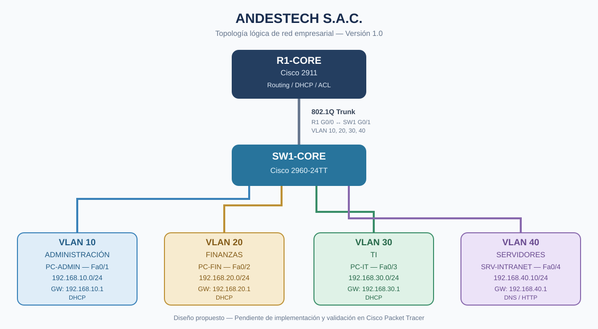

# Fase 02.4 — Diseño Lógico y Físico de la Red

## 1. Objetivo

Definir la arquitectura de red propuesta para AndesTech S.A.C., identificando los dispositivos, enlaces físicos, interfaces, VLAN y esquemas de direccionamiento necesarios para su implementación en Cisco Packet Tracer.

## 2. Topología lógica

La infraestructura estará compuesta por un router, un switch administrable, tres estaciones de trabajo y un servidor interno.

Se utilizará una arquitectura Router-on-a-Stick para proporcionar conectividad entre las VLAN mediante un enlace troncal IEEE 802.1Q.

**Figura 1.** Topología lógica propuesta para AndesTech S.A.C.

## 3. Inventario de dispositivos

| Identificador | Modelo | Cantidad | Función |
|---|---|---|---|
| R1-CORE | Cisco 2911 | 1 | Enrutamiento inter-VLAN, DHCP y ACL |
| SW1-CORE | Cisco 2960-24TT | 1 | Conmutación y segmentación mediante VLAN |
| PC-ADMIN | PC-PT | 1 | Estación de Administración |
| PC-FIN | PC-PT | 1 | Estación de Finanzas |
| PC-IT | PC-PT | 1 | Estación de TI |
| SRV-INTRANET | Server-PT | 1 | Servicios DNS y HTTP |

**Total:** 6 dispositivos.

## 4. Diseño de direccionamiento IPv4

| VLAN | Nombre | Red | Máscara | Gateway |
|---|---|---|---|---|
| 10 | ADMINISTRACION | 192.168.10.0/24 | 255.255.255.0 | 192.168.10.1 |
| 20 | FINANZAS | 192.168.20.0/24 | 255.255.255.0 | 192.168.20.1 |
| 30 | TI | 192.168.30.0/24 | 255.255.255.0 | 192.168.30.1 |
| 40 | SERVIDORES | 192.168.40.0/24 | 255.255.255.0 | 192.168.40.1 |

### 4.1 Asignación dinámica

Las estaciones de trabajo obtendrán sus direcciones mediante DHCP configurado en R1-CORE.

Se utilizarán los siguientes rangos previstos:

- Administración: 192.168.10.100–192.168.10.199.
- Finanzas: 192.168.20.100–192.168.20.199.
- TI: 192.168.30.100–192.168.30.199.

Estos rangos deberán implementarse mediante exclusiones DHCP apropiadas.

### 4.2 Asignación estática

El servidor SRV-INTRANET utilizará:

- Dirección IPv4: 192.168.40.10.
- Máscara: 255.255.255.0.
- Gateway: 192.168.40.1.
- DNS: 192.168.40.10.

## 5. Diseño físico

### 5.1 Conexiones

| Origen | Interfaz | Destino | Interfaz | Tipo |
|---|---|---|---|---|
| R1-CORE | G0/0 | SW1-CORE | G0/1 | Trunk |
| SW1-CORE | Fa0/1 | PC-ADMIN | Fa0 | Access VLAN 10 |
| SW1-CORE | Fa0/2 | PC-FIN | Fa0 | Access VLAN 20 |
| SW1-CORE | Fa0/3 | PC-IT | Fa0 | Access VLAN 30 |
| SW1-CORE | Fa0/4 | SRV-INTRANET | Fa0 | Access VLAN 40 |

Todas las conexiones utilizarán cable Copper Straight-Through dentro de Cisco Packet Tracer.

### 5.2 Enlace troncal

El enlace entre R1-CORE y SW1-CORE transportará las VLAN 10, 20, 30 y 40 mediante encapsulación IEEE 802.1Q.

No se utilizará la VLAN 1 para conectar equipos finales.

La configuración de la VLAN nativa y las medidas de endurecimiento del enlace se revisarán durante la implementación.

## 6. Subinterfaces del router

| Subinterfaz | VLAN | Dirección IPv4 |
|---|---|---|
| G0/0.10 | 10 | 192.168.10.1/24 |
| G0/0.20 | 20 | 192.168.20.1/24 |
| G0/0.30 | 30 | 192.168.30.1/24 |
| G0/0.40 | 40 | 192.168.40.1/24 |

La interfaz física G0/0 se utilizará como interfaz principal para las subinterfaces, sin asignarle directamente una dirección IPv4.

## 7. Servicios internos

### 7.1 DHCP

R1-CORE proporcionará direccionamiento automático a las estaciones de trabajo de las VLAN 10, 20 y 30.

### 7.2 DNS

SRV-INTRANET proporcionará resolución de nombres interna.

Se configurará inicialmente el siguiente registro:

| Nombre | Tipo | Dirección |
|---|---|---|
| intranet.andestech.test | A | 192.168.40.10 |

El dominio `.test` se utilizará exclusivamente para el laboratorio.

### 7.3 HTTP

SRV-INTRANET alojará una página web interna que permitirá verificar el acceso autorizado desde los departamentos.

## 8. Seguridad

Se implementarán ACL extendidas para controlar el tráfico entre VLAN.

La matriz de autorizaciones se encuentra documentada en:

`docs/03-politicas-acceso.md`

Se aplicará el principio de mínimo privilegio y se comprobará que las reglas no interrumpan los servicios autorizados.

## 9. Plan de implementación

1. Crear la topología física en Packet Tracer.
2. Configurar nombres e interfaces de los dispositivos.
3. Crear las cuatro VLAN en el switch.
4. Asignar puertos de acceso.
5. Configurar el enlace trunk.
6. Configurar las subinterfaces del router.
7. Implementar DHCP.
8. Configurar DNS y HTTP.
9. Verificar conectividad sin restricciones ACL.
10. Aplicar las políticas ACL.
11. Ejecutar las pruebas funcionales y de seguridad.
12. Documentar resultados e incidencias.

## 10. Evidencias previstas

Se recopilarán las siguientes evidencias:

- Topología física definitiva.
- Tabla de VLAN configuradas.
- Estado operativo de interfaces y del enlace trunk.
- Direccionamiento obtenido mediante DHCP.
- Conectividad hacia los gateways.
- Resolución DNS.
- Acceso al servidor HTTP.
- Tráfico permitido y bloqueado por ACL.
- Registro de incidencias y soluciones.

## 11. Limitaciones

El diseño corresponde a un laboratorio de aprendizaje.

No contempla conexión a Internet, redundancia, alta disponibilidad ni firewall de inspección con estado.

## 12. Estado

**Diseño lógico y físico propuesto.**

Pendiente de implementación, pruebas y validación en Cisco Packet Tracer.