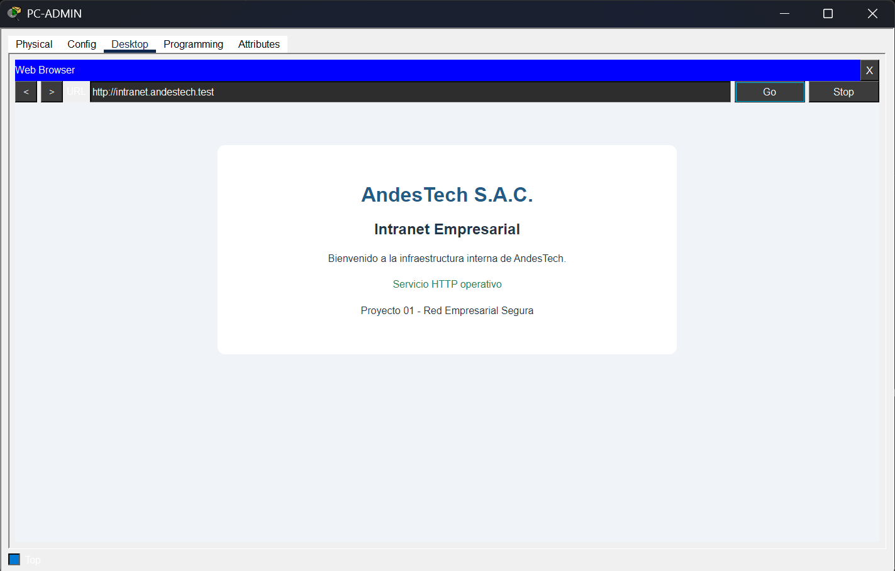
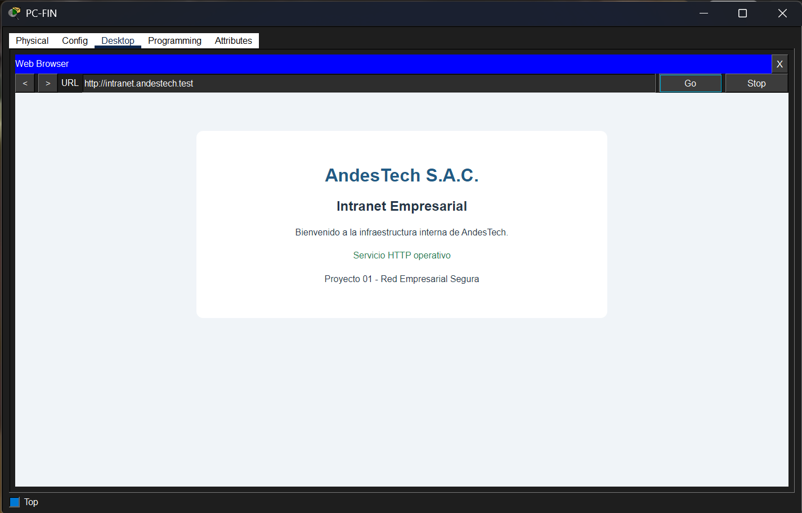
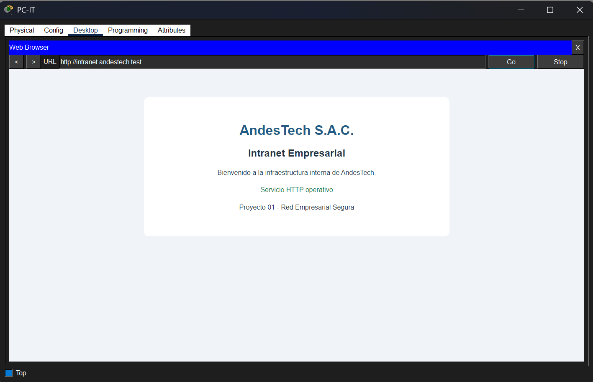
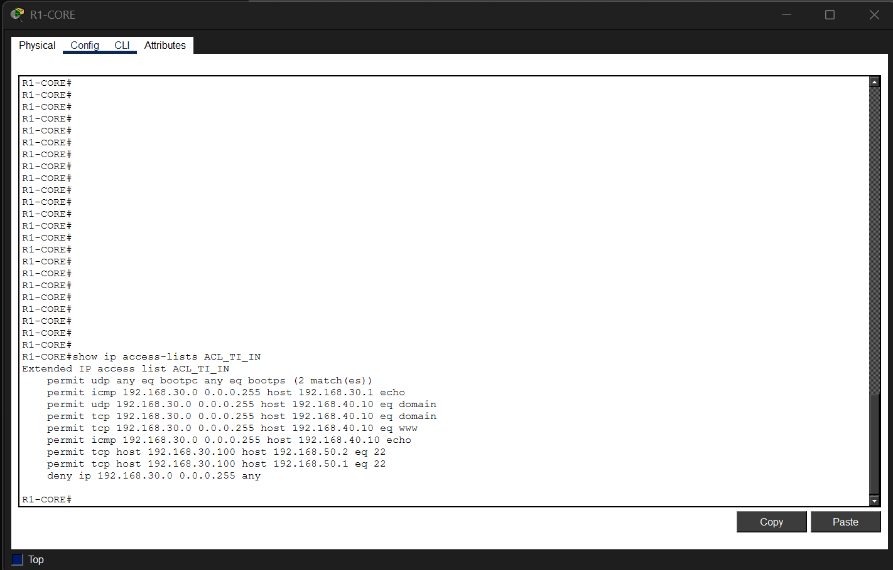
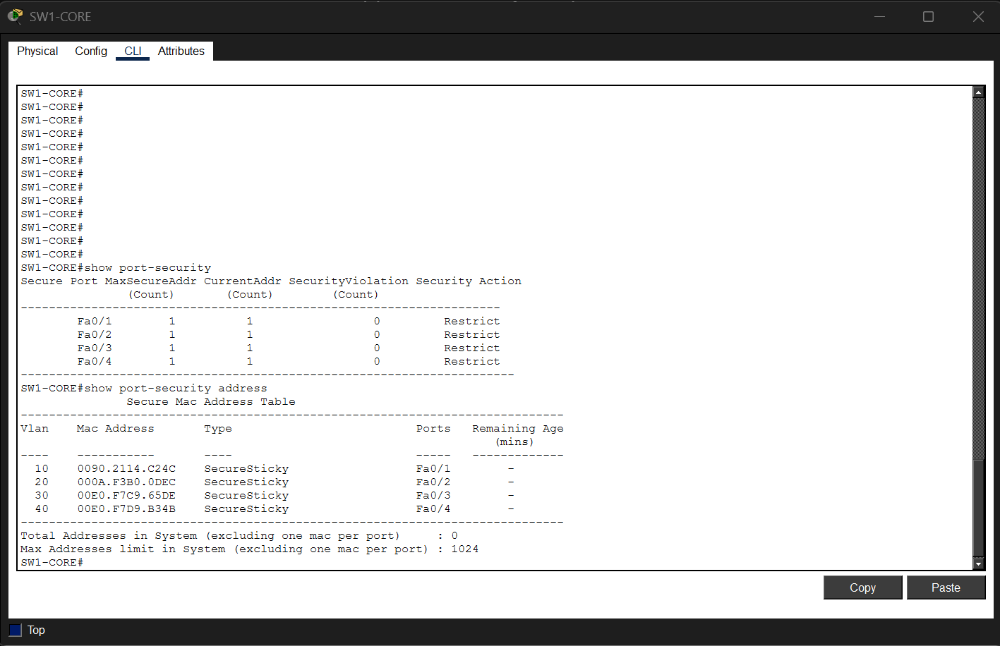
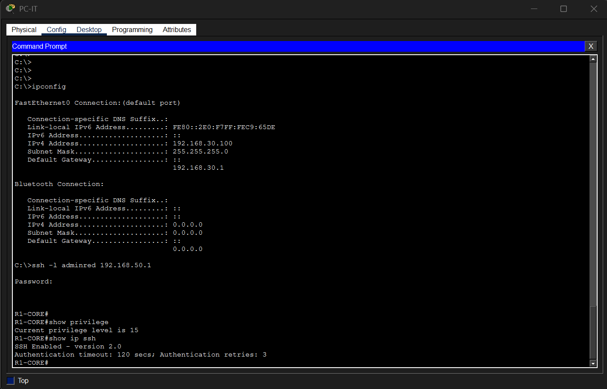
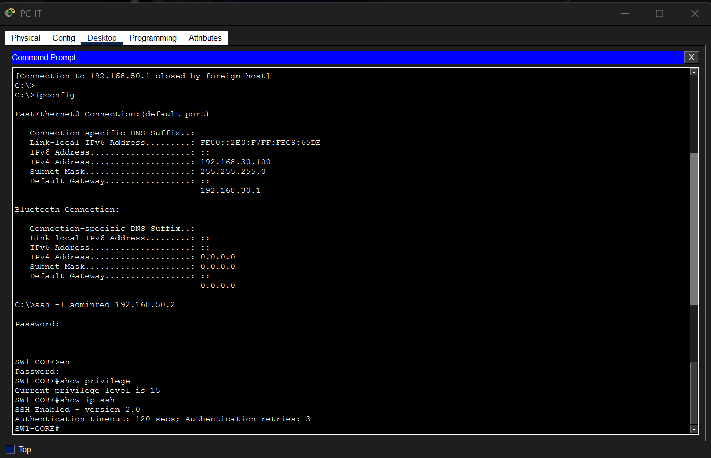
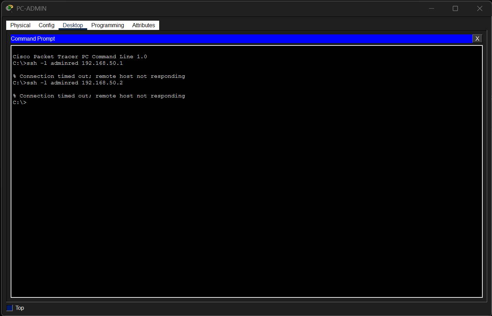
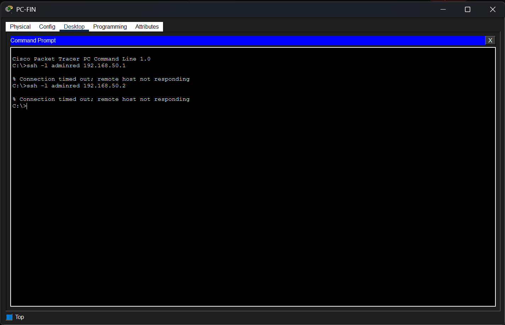

# 06. Pruebas y validación de la infraestructura

**Proyecto:** Implementación de una Red Empresarial Segura

**Organización simulada:** AndesTech S.A.C.

**Entorno:** Cisco Packet Tracer

**Alcance:** Conectividad, servicios, segmentación, controles de seguridad y administración remota

---

## 6.1. Objetivo

Validar el funcionamiento de la infraestructura de red empresarial implementada para AndesTech S.A.C., comprobando que los servicios autorizados permanezcan disponibles y que las restricciones de acceso se comporten según las políticas definidas.

Las pruebas se realizaron sobre una topología compuesta por un router Cisco 2911, un switch Cisco 2960, tres estaciones de trabajo y un servidor interno.

La validación incluyó:

- Estado operativo de interfaces y VLAN.
- Asignación de direcciones IPv4 mediante DHCP.
- Enrutamiento entre VLAN antes de aplicar restricciones.
- Resolución DNS y acceso a la intranet HTTP.
- Aplicación de ACL departamentales.
- Restricciones de acceso a la red de gestión.
- Seguridad de puertos del switch.
- Administración remota por SSH.
- Autenticación y privilegios administrativos.

## 6.2. Entorno de pruebas

### 6.2.1. Equipos utilizados

| Equipo | Dirección IPv4 | VLAN | Función |
|---|---|---|---|
| PC-ADMIN | 192.168.10.100 | 10 | Administración |
| PC-FIN | 192.168.20.100 | 20 | Finanzas |
| PC-IT | 192.168.30.100 | 30 | TI |
| SRV-INTRANET | 192.168.40.10 | 40 | DNS y HTTP |
| R1-CORE | 192.168.50.1 | 50 | Router y administración |
| SW1-CORE | 192.168.50.2 | 50 | Switch y administración |

Las tres computadoras obtuvieron su configuración IPv4 mediante DHCP. El servidor y las interfaces de gestión utilizan direcciones estáticas.

### 6.2.2. Direcciones de gateway

| VLAN | Gateway |
|---|---|
| 10 | 192.168.10.1 |
| 20 | 192.168.20.1 |
| 30 | 192.168.30.1 |
| 40 | 192.168.40.1 |
| 50 | 192.168.50.1 |

## 6.3. Metodología de validación

Las pruebas se ejecutaron progresivamente durante la implementación.

Se utilizó un procedimiento basado en las siguientes etapas:

1. Verificar la conectividad inicial sin restricciones de tráfico.
2. Configurar y comprobar los servicios de red.
3. Aplicar las ACL de manera progresiva.
4. Realizar pruebas de comunicaciones permitidas y denegadas.
5. Incorporar controles de seguridad en el switch.
6. Configurar la red de gestión y SSH.
7. Probar accesos administrativos autorizados y no autorizados.
8. Guardar las configuraciones y recopilar evidencias.

Esta secuencia permitió distinguir los problemas de conectividad básica de los efectos introducidos por las políticas de seguridad.

## 6.4. Validación de interfaces y VLAN

### Prueba VAL-01: Estado de interfaces del router

**Objetivo:** comprobar que las subinterfaces Router-on-a-Stick estén operativas.

Comando utilizado:

```cisco
show ip interface brief
```

**Resultado observado:** las subinterfaces GigabitEthernet0/0.10, 0/0.20, 0/0.30, 0/0.40 y 0/0.50 presentaron estado `up/up`.

**Conclusión:** la configuración de las subinterfaces y su conexión física se encuentran operativas.

### Prueba VAL-02: Configuración de VLAN

**Objetivo:** comprobar que las VLAN estén creadas y que los puertos tengan las asignaciones correspondientes.

Comando utilizado en SW1-CORE:

```cisco
show vlan brief
```

Se confirmó la existencia de las VLAN 10, 20, 30, 40, 50 y 999.

Los puertos Fa0/1 a Fa0/4 permanecieron asociados a los equipos finales y a sus VLAN respectivas.

### Prueba VAL-03: Enlace trunk 802.1Q

Comando utilizado:

```cisco
show interfaces trunk
```

**Resultado observado:**

- Interfaz Gi0/1 en modo trunk.
- Encapsulación 802.1Q.
- VLAN permitidas: 10, 20, 30, 40 y 50.
- Las cinco VLAN aparecieron en estado de reenvío de Spanning Tree después de estabilizarse el enlace.

**Conclusión:** el trunk transporta las VLAN utilizadas por la infraestructura.

## 6.5. Validación del servicio DHCP

### Prueba VAL-04: Asignación automática de IPv4

**Objetivo:** comprobar que cada estación obtenga una dirección de su departamento.

Comando utilizado en las computadoras:

```text
ipconfig
```

| Equipo | Dirección asignada | Resultado |
|---|---|---|
| PC-ADMIN | 192.168.10.100 | Exitoso |
| PC-FIN | 192.168.20.100 | Exitoso |
| PC-IT | 192.168.30.100 | Exitoso |

También se comprobaron las puertas de enlace respectivas.

**Conclusión:** el servicio DHCP proporcionó correctamente las configuraciones IPv4 a los tres clientes.

**Alcance:** esta prueba confirma las asignaciones observadas. No se documentó una prueba específica de renovación DHCP posterior a todos los cambios de seguridad.

## 6.6. Validación de conectividad y enrutamiento

### Prueba VAL-05: Comunicación con gateway local

Se ejecutaron pruebas ICMP desde cada estación hacia su gateway.

```text
PC-ADMIN: ping 192.168.10.1
PC-FIN:   ping 192.168.20.1
PC-IT:    ping 192.168.30.1
```

**Resultado observado:** las estaciones recibieron respuestas correctas de sus respectivos gateways.

### Prueba VAL-06: Enrutamiento inter-VLAN inicial

Antes de activar las ACL se probaron las comunicaciones entre Administración, Finanzas y TI.

**Resultado observado:** las comunicaciones ICMP entre los departamentos funcionaron, validando el enrutamiento inter-VLAN.

Este resultado sirvió como referencia antes de aplicar las restricciones de acceso.

## 6.7. Validación de DNS y HTTP

### Prueba VAL-07: Resolución y acceso a la intranet

**Objetivo:** comprobar que los tres departamentos puedan utilizar el servicio web interno a través de su nombre DNS.

Dirección utilizada:

```text
http://intranet.andestech.test
```

| Equipo | Resolución DNS y acceso HTTP | Resultado |
|---|---|---|
| PC-ADMIN | Acceso a la intranet | Exitoso |
| PC-FIN | Acceso a la intranet | Exitoso |
| PC-IT | Acceso a la intranet | Exitoso |

Se comprobó el acceso desde las tres computadoras y se repitieron verificaciones después de aplicar las políticas de seguridad.

**Conclusión:** la configuración de DNS y HTTP permite mantener el servicio de intranet disponible para los departamentos autorizados.

**Evidencias:**







## 6.8. Validación de políticas ACL

### Prueba VAL-08: Verificación de aplicación de ACL

Se ejecutaron los comandos:

```cisco
show ip access-lists
show ip interface gigabitEthernet 0/0.10
show ip interface gigabitEthernet 0/0.20
show ip interface gigabitEthernet 0/0.30
show ip interface gigabitEthernet 0/0.40
```

Se comprobó que las siguientes ACL estuvieran asociadas a sus respectivas subinterfaces en dirección de entrada:

| Subinterfaz | ACL |
|---|---|
| G0/0.10 | ACL_ADMIN_IN |
| G0/0.20 | ACL_FIN_IN |
| G0/0.30 | ACL_TI_IN |
| G0/0.40 | ACL_SERVIDORES_IN |

**Resultado:** las cuatro asociaciones se verificaron en el router.

### Prueba VAL-09: Comunicaciones departamentales

Las políticas permiten el acceso a los servicios internos necesarios y restringen las comunicaciones no autorizadas entre departamentos.

| Origen | Destino | Política esperada |
|---|---|---|
| PC-ADMIN | Gateway de Administración | Permitir ICMP |
| PC-ADMIN | PC-FIN | Denegar ICMP |
| PC-ADMIN | PC-IT | Denegar ICMP |
| PC-FIN | Gateway de Finanzas | Permitir ICMP |
| PC-FIN | PC-ADMIN | Denegar ICMP |
| PC-FIN | PC-IT | Denegar ICMP |
| PC-IT | Gateway de TI | Permitir ICMP |
| PC-IT | PC-ADMIN | Denegar ICMP |
| PC-IT | PC-FIN | Denegar ICMP |
| PC-IT | SRV-INTRANET | Permitir ICMP |

**Resultados observados:** durante las pruebas de las ACL se comprobaron respuestas permitidas hacia gateways, bloqueos entre departamentos y acceso ICMP desde TI al servidor.

### Prueba VAL-10: Servicios autorizados y servidor

Se verificó que los permisos DNS y HTTP continuaran permitiendo el acceso a la intranet después de aplicar las ACL.

También se comprobó que TI pudiera realizar ping hacia el servidor.

**Resultado observado:** los servicios autorizados continuaron funcionando.

**Limitación de evidencia:** no se registró una matriz completa de pruebas del servidor iniciando conexiones después de aplicar `ACL_SERVIDORES_IN`. La configuración está documentada, pero esa parte no debe presentarse como una validación exhaustiva.

**Evidencia de configuración ACL:**



## 6.9. Validación de la VLAN de gestión

### Prueba VAL-11: Comunicación entre router y switch

**Objetivo:** comprobar la disponibilidad de la red de administración.

Desde R1-CORE:

```cisco
ping 192.168.50.2
```

Se obtuvieron los siguientes resultados:

| Ejecución | Resultado |
|---|---|
| Primer intento | 60 % (3/5) |
| Segundo intento | 100 % (5/5) |

La diferencia inicial fue compatible con el proceso de inicialización o resolución de direcciones del entorno simulado.

**Conclusión:** se confirmó conectividad entre R1-CORE y SW1-CORE a través de VLAN 50.

## 6.10. Validación de Port Security

### Prueba VAL-12: Aprendizaje de direcciones MAC

En SW1-CORE se ejecutaron:

```cisco
show port-security
show port-security address
```

Resultados:

| Puerto | VLAN | Dirección MAC segura | Tipo |
|---|---|---|---|
| Fa0/1 | 10 | 0090.2114.C24C | SecureSticky |
| Fa0/2 | 20 | 000A.F3B0.0DEC | SecureSticky |
| Fa0/3 | 30 | 00E0.F7C9.65DE | SecureSticky |
| Fa0/4 | 40 | 00E0.F7D9.B34B | SecureSticky |

Cada puerto mostró:

- Límite de una MAC segura.
- Una MAC aprendida.
- Acción de infracción `restrict`.
- Cero infracciones registradas.

**Resultado:** Port Security se encuentra activo y aprendió las direcciones MAC de los cuatro dispositivos conectados.

No se realizó una prueba documentada de conexión de un equipo intruso o suplantación de MAC; por tanto, las cero infracciones representan el estado observado, no una prueba de resistencia a todos los ataques.

**Evidencia:**



## 6.11. Validación de SSH

### Prueba VAL-13: Administración de R1-CORE desde TI

Desde PC-IT se ejecutó:

```text
ssh -l adminred 192.168.50.1
```

Resultados comprobados:

| Comprobación | Resultado |
|---|---|
| Conexión SSH | Exitosa |
| Dispositivo | R1-CORE |
| Versión SSH | 2.0 |
| Privilegio administrativo | 15 |

**Evidencia:**



### Prueba VAL-14: Administración de SW1-CORE desde TI

Desde PC-IT:

```text
ssh -l adminred 192.168.50.2
```

Se comprobó el acceso remoto al switch mediante SSHv2.

En la sesión validada se accedió posteriormente al modo privilegiado mediante `enable`.

| Comprobación | Resultado |
|---|---|
| Conexión SSH | Exitosa |
| Dispositivo | SW1-CORE |
| Versión SSH | 2.0 |
| Privilegio 15 | Alcanzado mediante `enable` |

**Evidencia:**



### Prueba VAL-15: Acceso SSH denegado desde Administración

Desde PC-ADMIN se ejecutaron:

```text
ssh -l adminred 192.168.50.1
ssh -l adminred 192.168.50.2
```

En ambos intentos se observó:

```text
% Connection timed out; remote host not responding
```

**Resultado:** PC-ADMIN no logró establecer una sesión administrativa con el router ni con el switch.

**Evidencia:**



### Prueba VAL-16: Acceso SSH denegado desde Finanzas

Desde PC-FIN se verificó la denegación de conexiones administrativas hacia ambos dispositivos.

**Resultado informado:** los intentos no permitieron establecer sesiones SSH.

**Evidencia archivada:**



## 6.12. Validación de autenticación local

### Prueba VAL-17: Acceso por consola

Se configuró autenticación local mediante `login local` en ambos dispositivos.

En R1-CORE se comprobó el inicio de sesión con usuario y contraseña y se obtuvo:

```text
Current privilege level is 15
```

En SW1-CORE se validó la autenticación del usuario y el acceso posterior
